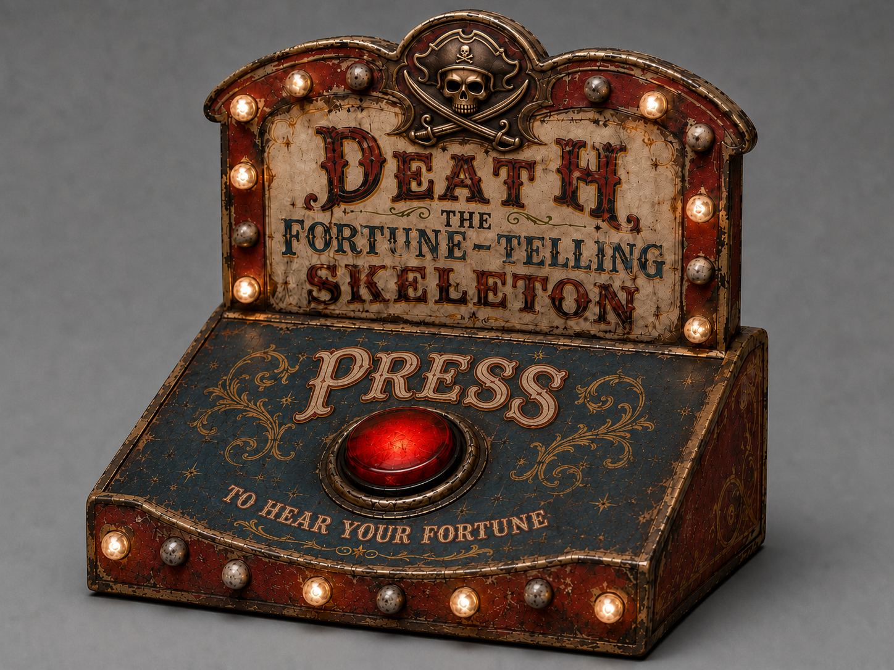

# Box of Death

A handmade, battery-powered carnival button box for **Death, the fortune-telling skeleton**. Press the large illuminated red button to ask Death for a fortune. An ESP32 will deliver the trigger through Matter, with animated marquee lights around an aged wood, glass, and metal enclosure.



*Generated front reference from the design conversation. The physical build is still in progress.*

This repository holds the design, physical build, hardware references, and eventual electronics and firmware for the box. Death's skeleton controller, sound, and motion belong to the companion projects.

Companion projects: [Death, the Fortune Telling Skeleton](https://github.com/copperdogma/death-fortune-teller) and its [Death Matter Controller](https://github.com/copperdogma/death-matter-controller). The latter sits inside the skeleton; this button box is a separate device.

## Start here

- **[Project specification](docs/project-specs.md)** — requirements, dimensions, exact paint palette, hardware specifications, bill of materials, decisions, and open questions.
- **[Build guide and design history](docs/build-guide.md)** — enclosure construction, copper work, lighting, finishing, assembly, and a source coverage index.
- **[September 9–12 decisions](docs/recent-decisions-2026-09-12.md)** — recent chat sources, copper purchase/templates, fasteners, carving setup, and projection artwork.
- **[Image gallery](images/gallery.html)** — recovered concepts, design variations, construction photos, and materials. Download the repository and open this file in a browser; GitHub also lets you browse the [image files](images/).
- **[Hardware references](hardware-specs/)** — original standalone product photographs and button dimensions.

## Current state

As recorded in the conversations reviewed through **September 12, 2026**, the wooden clamshell and curved crown are assembled, fitted, filled, sanded, cleaned, and primed with oil-based KILZ. The five-color paint scheme is selected. Real copper edging is now selected and the sheet purchased (91.5 × 25.5 cm, about 0.8 mm, reported $90). Paper edge templates are complete; rounded leading edges and real copper fastener heads are the chosen direction. Measured shell dimensions are recorded, and upright/deck artwork for projector tracing is in progress. Finishing, decorative hardware, lighting installation, electronics integration, and working Matter behavior are not yet documented as complete.

There is no firmware, final schematic, CAD, or complete measured as-built drawing. Builder-reported overall measurements are now included in the specification. Dimensions derived from concept renders are labeled as estimates. The documentation distinguishes completed work, selected directions, and earlier experiments.

## Project log

**The ongoing project log is in the Apple Note titled “Box of Death.”** When the project is complete, that note will be copied into this repository for posterity. It has not yet been imported; the documents here were reconstructed from the project conversations and saved hardware references.

## Where this record came from

The initial import covers all 91 turns of the **Box of Death** conversation, plus the related **Woodworking Box Construction**, **Aging Copper Patina**, and **Resistors vs Converter for LED** conversations. The build guide records source references so later corrections can be traced. The September 12 follow-up adds recent turns from the main chat, its two branches, and Plan 2D Projections; the source review distinguishes user decisions from untested assistant suggestions. The image manifest retains original names and source identifiers; alternate renders are historical concepts, not photographs of the finished object.

A complete transcript and retrieval records are preserved locally under `.local/source-archive/`, which is ignored by Git. The original retailer PDFs and one retailer screenshot also remain local and ignored because they include account or delivery-location details. Their relevant specifications are included in the public documents, with clean product links where available.

## Repository layout

```text
README.md                 Project overview and current status
AGENTS.md                 Working conventions for future project work
docs/project-specs.md     Current specification, hardware, and open decisions
docs/build-guide.md       Construction methods, history, and source index
images/gallery.html       Browse the image archive locally
images/manifest.json      Image provenance and checksums
images/concept/           Front, rear, trim, and mounting design iterations
images/build/             Construction photos and physical template
images/drawing/           Original sketch and conceptual diagrams
images/hardware/          Clean button and MOSFET product images
images/supply/            Paint, primer, copper, brushes, and glue
images/reference/         Logos, measured silhouette templates, and editable artwork sources
images/art/               Local upright/deck artwork exports
hardware-specs/           Original product photographs
.local/                   Private source archive; excluded from Git
```

## Continuing the build

Start with the [open work in the specification](docs/project-specs.md#acceptance-criteria-and-open-work). Verify the recorded rounded measurements and fill remaining panel/cutout and component-identity gaps before producing a cut list or wiring plan. Update the two documents and add build photos as decisions become physical results.

No repository license has been selected yet. Retailer photographs retain their original ownership; archiving a reference image does not grant a new license to it.
